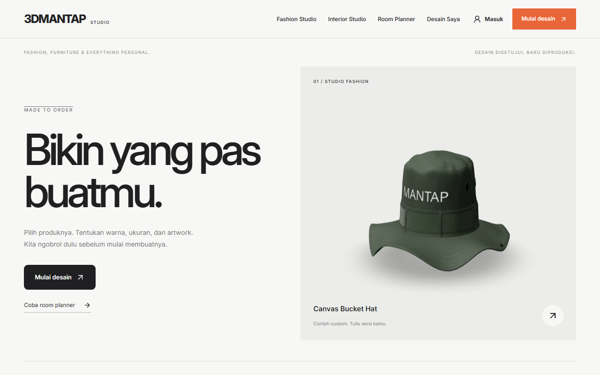
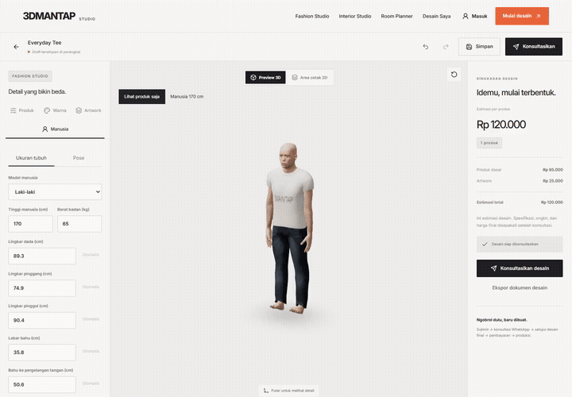
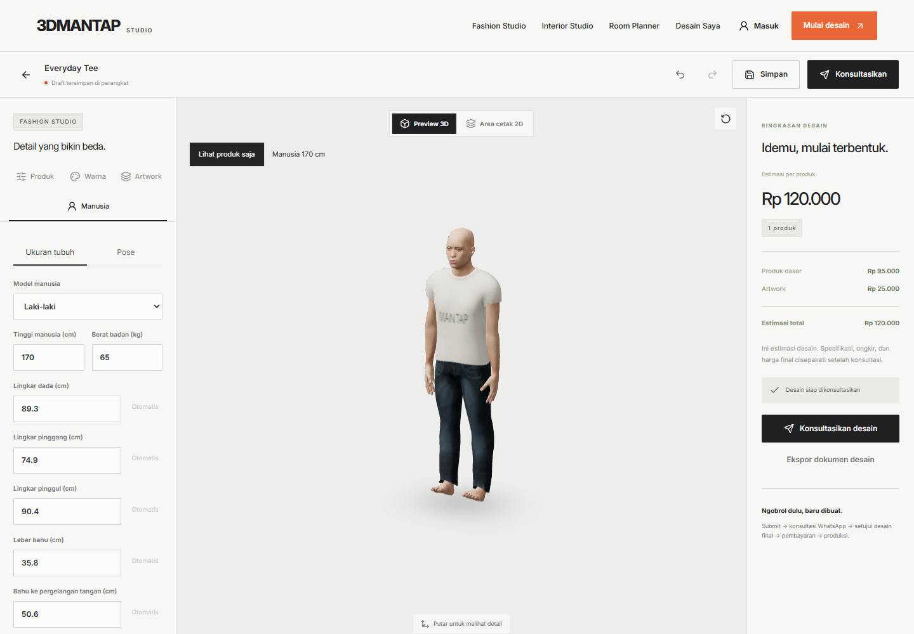
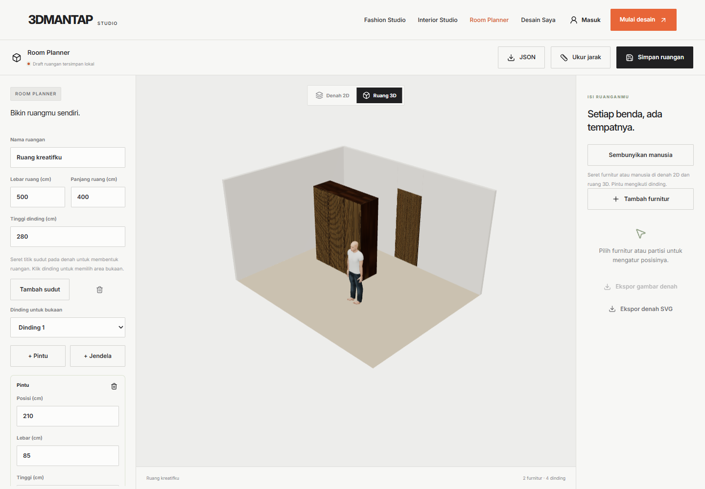
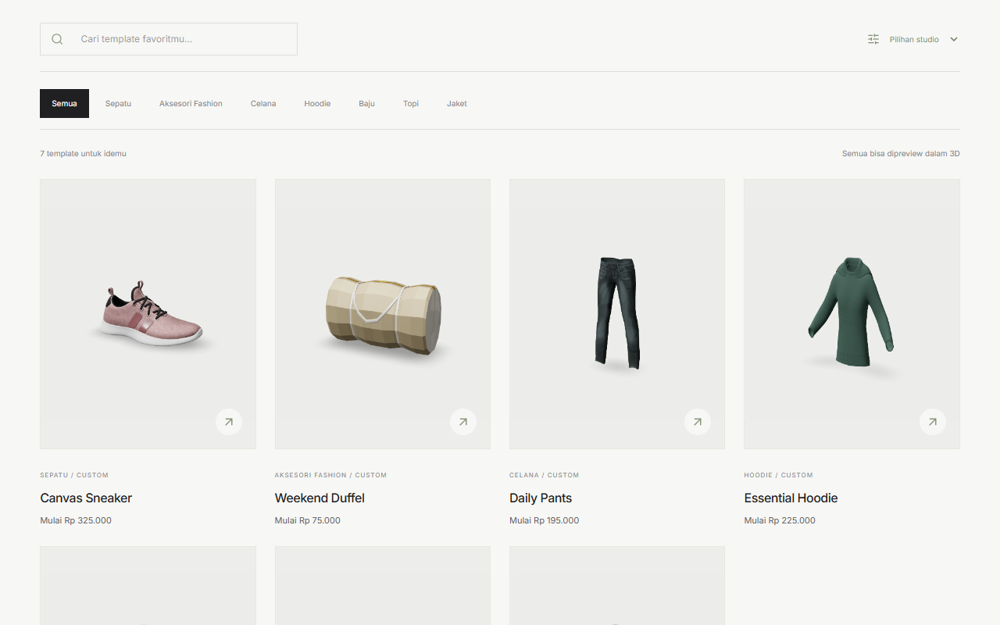
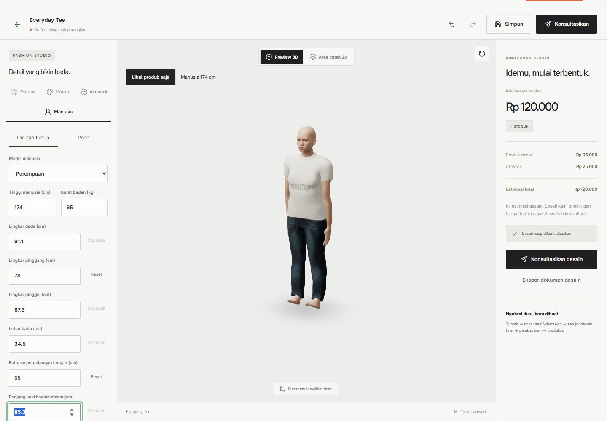
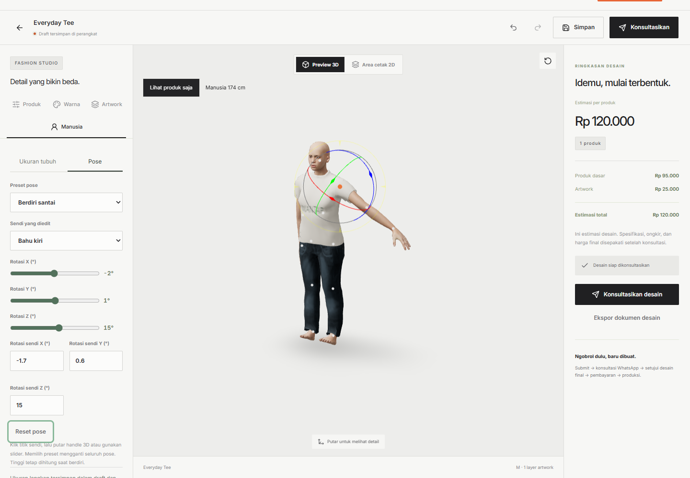

<div align="center">

# 3DMantap

**Design it. See it in 3D. Consult before production.**

An open-source customization studio for fashion, furniture and the spaces they belong in.

[](https://github.com/bayurifkialghifari/3dmantap/actions/workflows/quality.yml)
[](LICENSE)
[](https://www.typescriptlang.org/)
[](https://bun.sh/)

[Get started](#get-started) · [Watch the demo](#demo) · [Documentation](docs/README.md) · [Contribute](CONTRIBUTING.md)

</div>



3DMantap combines product customization, a 2D/3D room planner and a consultation CMS in one TypeScript application. Add artwork, preview clothing on a person, place furniture at physical scale and submit a design for review over WhatsApp before production.

The UI is **Bahasa Indonesia**, with integer IDR prices and dimensions stored in millimeters. This release supports a single business. Starter products and prices are demonstration data.

## Demo

[](docs/media/demo.mp4)

**[Watch or download the video (MP4)](docs/media/demo.mp4)** · [Recording and asset credits](docs/media/README.md)

[](docs/media/avatar-demo.mp4)

**[Watch body measurements & poses (MP4)](docs/media/avatar-demo.mp4)** — male/female selection, manual body measurements, presets, joint controls and a seated room reference.

Recorded from the local application with synthetic designs. The demos show the storefront, fashion catalog, artwork on worn clothing, male/female bodies, measurement controls, poses and room planning. It does not submit a customer order.

## Features

| Studio          | Included behavior                                                                                                                                                                              |
| --------------- | ---------------------------------------------------------------------------------------------------------------------------------------------------------------------------------------------- |
| Fashion         | Shirts, hoodies, jackets, pants, hats, sneakers and bags; colors, sizes, quantities and uploaded artwork. Built-in garments follow male/female bodies with measurements, poses and UV artwork. |
| Interior        | Parametric cabinets, shelves, desks, sideboards, doors and panels; dimensions, materials, doors/drawers, artwork and physical panel geometry.                                                  |
| Room planner    | Polygon rooms, editable corners, partitions, windows and wall-mounted doors. Drag furniture and a reference human in 2D/3D, compare heights and export PNG/SVG/JSON.                           |
| Business CMS    | Product templates, inquiries, consultation notes, quote revisions, customer approval, verified transfers, progress photos and production jobs.                                                 |
| Production      | Text/image layers, physical print surfaces, 300 DPI artwork, actual-size PDF, print tiles and furniture cut lists from the approved revision.                                                  |
| Library and PWA | Autosave, cloud designs, token-based sharing, accounts and offline public models/fonts/drafts. Private API files stay outside offline caching.                                                 |

## Screenshots

| Customize clothing                                                            | Plan a room at physical scale                                                   |
| ----------------------------------------------------------------------------- | ------------------------------------------------------------------------------- |
|  |  |



| Body measurements                                                     | Joint poses                                                                   |
| --------------------------------------------------------------------- | ----------------------------------------------------------------------------- |
|  |  |

Private measurement profiles stay with the design/room and consultation snapshot. Public links carry the visual body/pose recipe. See [body measurements & poses](docs/body-poses.md).

## Get started

Install **Bun 1.4.4+**, **Git** and **MySQL 8.4+**. Chromium is needed for browser tests and thumbnail capture.

```sh
git clone https://github.com/bayurifkialghifari/3dmantap.git
cd 3dmantap
bun install --frozen-lockfile
bun run setup
```

Setup creates environment secrets and an admin password at **.data/bootstrap-admin.txt**. On Windows, if mysqld is on PATH, it initializes an isolated development database in .data/mysql and starts it on **127.0.0.1:33307**.

On Linux/macOS, or with your own database, set DATABASE_URL in .env before migrating. Use an account permitted to create/migrate the configured database. Setup preserves existing environment files; seeding preserves edited templates/settings.

```sh
bun run db:migrate
bun run db:seed
bun run dev
```

Open **http://localhost:5173**. The API uses **3001**; dev also starts the export worker. Sign in at /login with the generated credentials, then open /admin for CMS.

## Consultation comes first

1. Customers customize a product and submit their design and requirements.
2. The submission and snapshot persist in CMS before the WhatsApp action appears.
3. The customer sends the WhatsApp message; admin records the consultation outcome.
4. Admin publishes the final design/quote revision. The customer approves that current revision.
5. The customer uploads transfer evidence; admin verifies the required payment.
6. The backend permits production and the worker creates a revision-bound packet.

Opening WhatsApp never counts as approval. Revisions reset approval, and stale approval/payment actions cannot unlock production. Configure WhatsApp, bank details, fulfillment, prices and templates in CMS before taking real orders.

## Stack and structure

| Layer   | Technology                                                                        |
| ------- | --------------------------------------------------------------------------------- |
| Web     | React, Vite, strict TypeScript, TanStack Router/Query, Zustand and atomic UI      |
| Canvas  | Three.js, React Three Fiber/Drei, sourced GLBs and Konva                          |
| API     | Bun, modular Hono services, shared Zod contracts and Better Auth                  |
| Data    | MySQL, Drizzle, private uploads and persistent export jobs                        |
| Tooling | ESLint, Prettier, Bun tests, Playwright, glTF Transform, Sharp and GitHub Actions |

```text
apps/web/          Atomic components, pages and feature hooks/renderers
apps/api/          Modular API, database and export worker
packages/shared/   Contracts, geometry, pricing and production rules
scripts/           Setup, development and model processing
tests/e2e/         Browser workflows
docs/              Feature guides, asset credits and demo media
```

Read the [architecture](architecture.md), [PRD](PRD.md), [21-feature documentation index](docs/README.md) and [changelog](CHANGELOG.md).

## Quality checks

```sh
bun run lint
bun run format:check
bun run typecheck
bun run docs:check
bun run test
bunx playwright install chromium
bun run test:e2e
bun run build
```

Integration tests use the configured MySQL database and clean up their records. Browser tests use the local app and seeded admin. Temporary screenshots/traces stay in ignored .data, test-results and playwright-report. CI runs the same checks with an isolated MySQL service.

## Models and limits

Nine runtime GLBs are bundled with source/license information and SHA-256 integrity records. Clothing/body share compatible MakeHuman rest poses; furniture is assembled from sourced panels. Sneaker scaling preserves source proportions.

```sh
bun run models:prepare
# Start the local app before rendering thumbnails:
bun run models:previews
bun run models:previews shoe
```

Worn previews support visual body measurements and joint poses. They do not simulate cloth or certify garment fit; hats, shoes, bags and arbitrary uploaded GLBs are not fitted to the human. Room placement checks object centers and wall-opening gaps, without furniture collision detection. Production packets do not generate sewing patterns, embroidery or CNC toolpaths. See [human preview](docs/human-preview.md) and [model sources](docs/model-assets.md).

## Deployment

Docker runs the app, worker and MySQL with persistent database/upload volumes.

```sh
cp .env.production.example .env.production
# Fill in the public origin and your own credentials/secrets.
docker compose --env-file .env.production up -d --build
```

Place an HTTPS reverse proxy in front of **127.0.0.1:3001**. APP_URL must match the public origin; forward Host/X-Forwarded-Proto. Health: /api/v1/health. Back up database and uploads together and test restores separately. The local app/build is tested; the complete Docker stack still needs verification on a Docker host.

Without Docker, supervise **bun run start** and **bun run worker** after building and configuring MySQL/storage.

## Contributing and security

Issues, focused pull requests and documentation improvements are welcome in Indonesian or English. Follow [CONTRIBUTING.md](CONTRIBUTING.md) and [AGENTS.md](AGENTS.md). Report vulnerabilities privately as described in [SECURITY.md](SECURITY.md).

## License and credits

Application code is **[MIT licensed](LICENSE)**. Third-party models retain CC0/CC BY 4.0 licenses; bundled fonts use SIL Open Font License. See [model credits](docs/model-assets.md), /models/credits.html and the license files in apps/web/public/fonts.

Created by [bayurifkialghifari](https://github.com/bayurifkialghifari).
